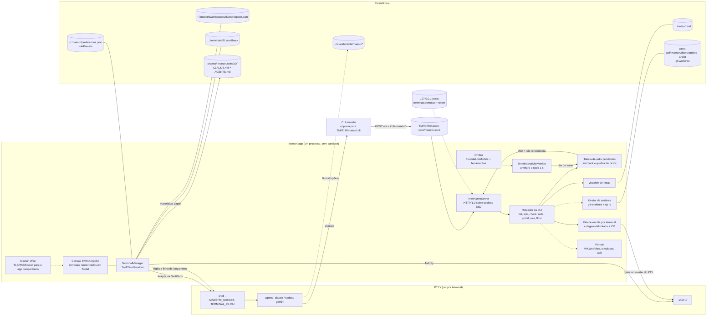
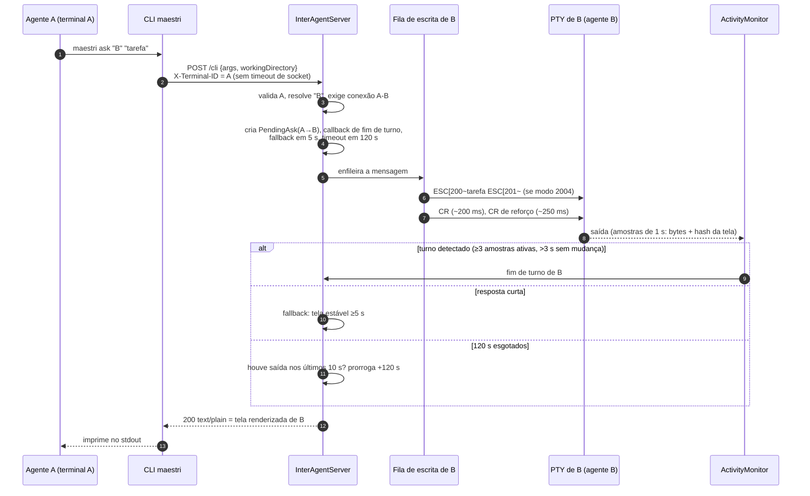
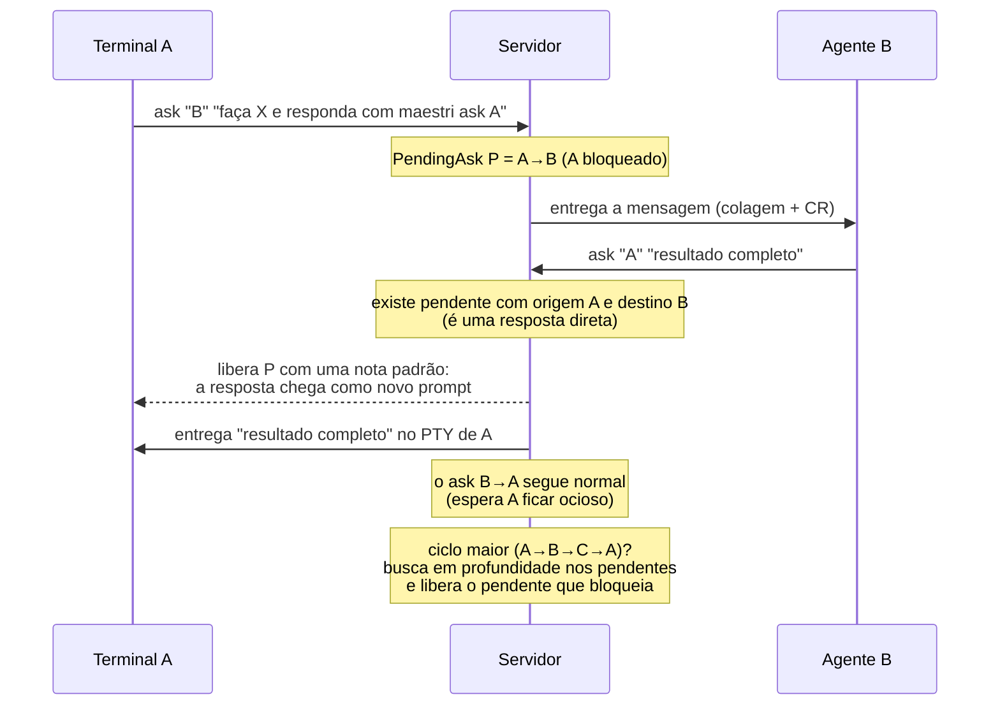
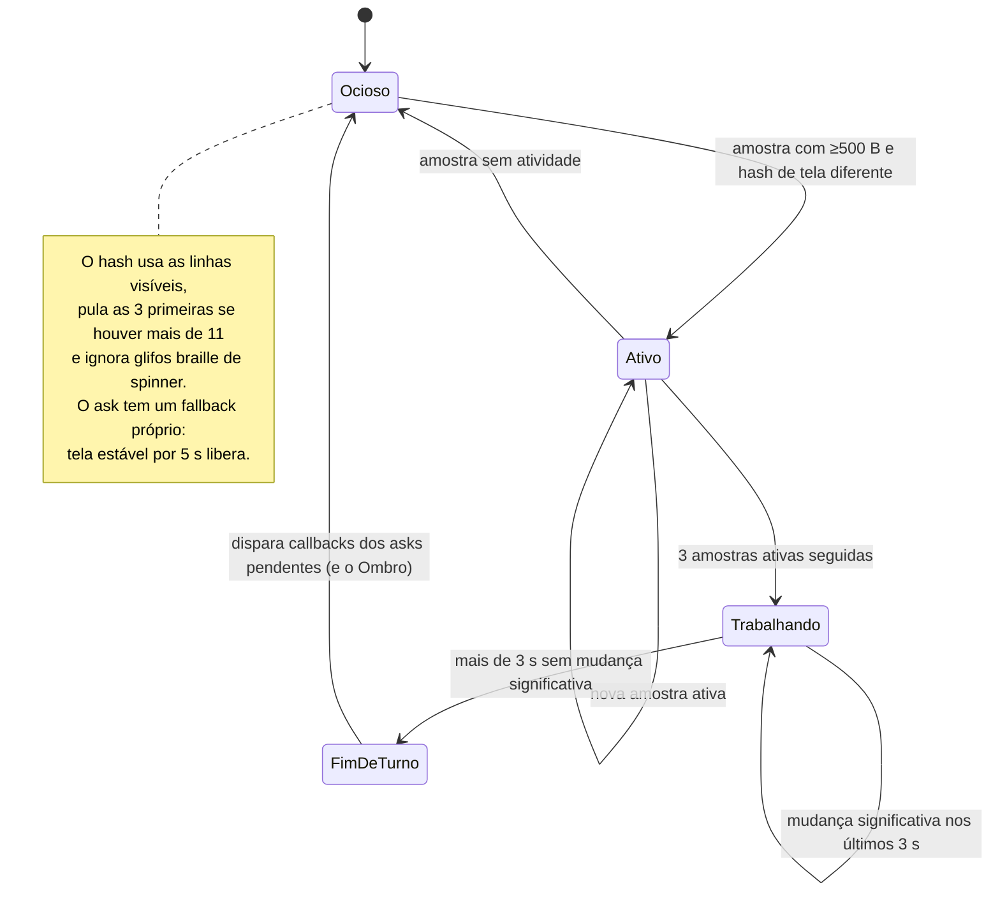
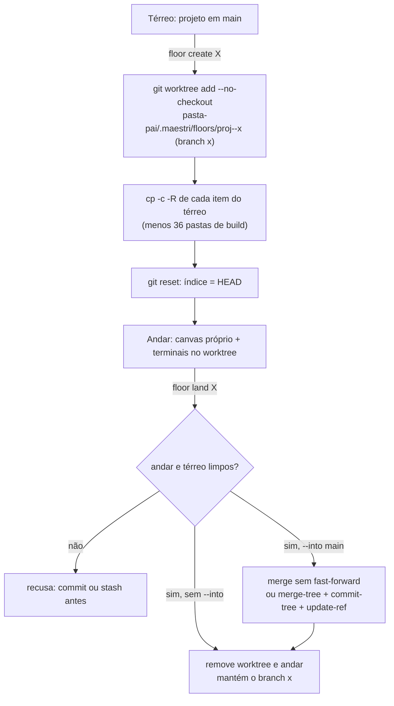

# Arquitetura do Maestri (reconstruída)

Os diagramas resumem o que está em `01-investigacao-maestri.md`. As setas com linha cheia foram observadas; as tracejadas foram inferidas pelo estático.

## Visão geral: processos, PTYs, CLI, IPC e persistência

## Sequência: `ask` bloqueante

## Sequência: ask back (resposta direta)

## Detecção de término: estados por terminal

## Andares: criar e aterrissar

