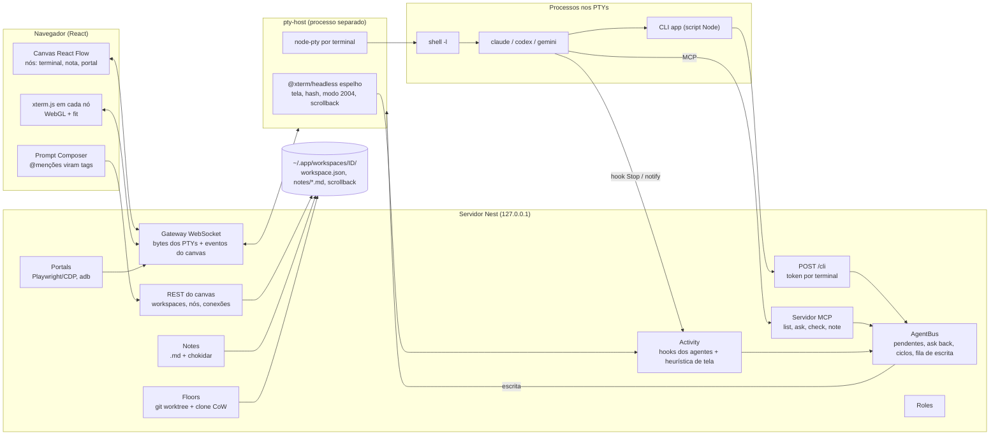

# Proposta de arquitetura: sua versão (Node + navegador em localhost)

## Sobre "React ou Nest no frontend"

NestJS é um framework de **backend**. A combinação recomendada é:

- **Backend:** Node.js 22 LTS com **NestJS**. A injeção de dependências e os módulos de Nest ajudam a separar terminais, barramento de agentes, notas, andares e portais. Se preferir algo mais enxuto, Fastify puro também serve.
- **Frontend:** **React + Vite**, com **React Flow** (`@xyflow/react`) para o canvas e **xterm.js** (`@xterm/xterm` + addon WebGL) dentro dos nós.
- **Execução:** tudo roda em `http://127.0.0.1:<porta>` e abre no navegador.

## Visão geral



## Onde fazer diferente do Maestri

| # | Tema | Como o Maestri faz | Sugestão | Por quê |
|---|---|---|---|---|
| 1 | **Fim do turno** | Só heurística de tela: amostras de 1 s, ≥500 B, 3 s de silêncio ou fallback de 5 s | **Hooks nativos** como sinal principal. No Claude Code, um hook `Stop` passado só para aquela sessão via `claude --settings '{…}'`, sem mexer nos arquivos do usuário. No Codex, `notify` (evento `agent-turn-complete`). A heurística de tela fica como reserva. | Fim de turno exato e imediato, sem os ~5 s de espera e sem falsos positivos quando o agente "pensa" sem imprimir. |
| 2 | **Conteúdo da resposta** | Devolve a tela renderizada inteira, com moldura da TUI, barra de status e possível corte | Devolver a **última mensagem do assistente**. O hook `Stop` do Claude traz `transcript_path`; o `notify` do Codex traz `last-assistant-message`. A tela fica como reserva. | Resposta limpa e completa, sem lixo de interface. Elimina boa parte da necessidade do "ask back". |
| 3 | **Remetente** | A mensagem chega crua; o destino não sabe quem pediu | Envelope curto (`[de: Nome · pedido id]`) e um comando `reply <id>` | O destino sabe a quem responder sem precisar de instrução manual. |
| 4 | **Pedidos longos** | Conexão HTTP bloqueada sem timeout; o agente que pede sofre com o timeout da própria ferramenta de shell | Modo assíncrono (`ask` devolve um id, `wait <id>`) **ou** caixa de entrada: a resposta é entregue sozinha como nova mensagem ao remetente | O timeout da ferramenta do agente deixa de importar. |
| 5 | **Interface com os agentes** | CLI no PATH, cópia em `$TMPDIR`, skills, `MAESTRI_CLI` como alternativa | Um **servidor MCP** (ferramentas `list`, `ask`, `check`, `note_read`, `note_write`) **além** da CLI, passado por sessão (Claude: `--mcp-config`; Codex: `mcp_servers` na config) | Sem problemas de PATH ou rc, com entrada e saída tipadas. A CLI continua para shells e para agentes sem MCP. |
| 6 | **Papéis** | O agente abre com cwd na pasta do papel, que tem `CLAUDE.md`/`AGENTS.md` | Usar mecanismos nativos quando existem: no Claude, `--append-system-prompt` ou `--settings`. Manter o truque do cwd como **reserva universal**. | Com o truque, o cwd do agente deixa de ser o projeto: o histórico de sessões se separa e as ferramentas do agente começam fora do projeto. |
| 7 | **Transporte local** | Socket Unix em `$TMPDIR` mais um listener TCP separado para uso remoto | **Um só** HTTP em `127.0.0.1` com token por terminal, num arquivo de descoberta `~/.app/run/<id>.json` | Funciona igual no Windows, onde não há o mesmo socket Unix. O mesmo servidor atende a CLI, o MCP e o navegador. |
| 8 | **Segurança no navegador** | App nativo, não exposto ao navegador | Escuta só em 127.0.0.1, token de sessão, verificação de `Host` e `Origin` (contra DNS rebinding), WebSocket autenticado, nada sem token | Quem acessa o servidor consegue rodar comandos nos terminais; um site malicioso aberto no navegador não pode chegar nele. |
| 9 | **Portais web** | WKWebView com JS injetado, refs `data-mref` e eventos de mouse nativos | **Playwright/Chromium** no servidor. O `page.ariaSnapshot()` já dá a árvore de acessibilidade em YAML. Cliques via CDP saem com `isTrusted: true`. Para mostrar no canvas, use o screencast do CDP. Também dá para aproveitar o Playwright MCP. | Num app de navegador, sites de terceiros não abrem em `iframe` (X-Frame-Options/CSP), então o browser tem de rodar no servidor. O Playwright entrega pronto o que o Maestri construiu à mão. |
| 10 | **Simulador iOS** | Dylib de acessibilidade compilada em runtime e injetada com `DYLD_INSERT_LIBRARIES`, mais HID privado do SimulatorKit | Deixar para depois. Se precisar, usar XCUITest/WebDriverAgent ou `idb` | A abordagem do Maestri é poderosa, mas frágil: depende de APIs privadas e quebra a cada versão do Xcode. |
| 11 | **Android** | `adb` + `uiautomator dump` + `input` | **Igual** | É o caminho padrão e funciona bem. |
| 12 | **Andares** | `git worktree add --no-checkout` + `cp -c -R` + `git reset`; land sem merge por padrão; merge sem checkout | **Igual**. Em Node, rode `cp -c -R` no macOS e `cp --reflink=auto -R` no Linux, ou use `fs.copyFile` com `COPYFILE_FICLONE`. | Boa solução. Pule de início a mescla sem checkout (`merge-tree`) e os submódulos. |
| 13 | **Notas** | Arquivos `.md` + watcher, nome tirado da primeira linha | **Igual**, com `chokidar`. Prefira **nome estável** por padrão. | Agentes editam `.md` com as próprias ferramentas. A renomeação automática confunde quem endereça a nota pelo nome. |
| 14 | **Persistência dos terminais** | tmux opcional e linha de retomada lida da tela | Um **pty-host** em processo separado, que sobrevive a reinícios do servidor web. Scrollback salvo com `@xterm/addon-serialize`. tmux continua opcional. | Reiniciar o backend durante o desenvolvimento não mata os agentes. |
| 15 | **Zoom do canvas** | Renderizador Metal; congela a imagem durante o zoom e re-renderiza no fim | Durante o zoom, `transform` do CSS no nó; ao terminar, ajustar o tamanho da fonte ou o fit. Abaixo de certo zoom, mostrar uma miniatura estática do texto. | É o mesmo princípio de congelar e redesenhar. xterm.js com WebGL aguenta vários terminais visíveis. |
| 16 | **Resumos (Ombro)** | Apple FoundationModels, local, sem alternativa | Opcional: um modelo pequeno via API ou local (Ollama), com as mesmas "ferramentas" (listar terminais, ler buffer, ler e escrever nota) | Não depende de Apple Intelligence e funciona em qualquer SO. |
| 17 | **Laços entre agentes** | Detecta ciclos de espera, mas não limita conversas sem fim | TTL e contador de saltos no envelope, limite de pedidos por minuto por terminal e um botão de "pausar a conversa" | Agentes perguntando um ao outro em laço custam caro. |

## Módulos do backend (Nest)

| Módulo | Responsabilidade |
|---|---|
| `WorkspaceModule` | CRUD de workspaces, nós e conexões. Persiste em `workspace.json` com escrita atômica (temporário + rename), no envelope `{type, schemaVersion, payload}`. |
| `PtyModule` | Cliente do **pty-host**: criar, escrever, redimensionar, matar, inscrever-se em bytes. Cria login shells (`$SHELL -l`), injeta o ambiente (seção 3 da spec) e digita a linha de lançamento do agente. |
| `ActivityModule` | Recebe os hooks dos agentes (`POST /hooks/claude/stop`, `POST /hooks/codex/notify`). Roda a heurística de tela sobre o `@xterm/headless` como reserva e emite `turnEnded(terminalId, finalMessage?)`. |
| `AgentBusModule` | `list`, `ask`, `ask --raw`, `ask --batch`, `check`; tabela de pendentes; ask back e ciclos; fila de escrita por terminal com colagem delimitada e CRs. Ver `03-spec-agentes-conversam.md`. |
| `CliGatewayModule` | `POST /cli` (texto puro, status HTTP). Autentica por `X-Terminal-ID` + token. |
| `McpModule` | Servidor MCP (via `@modelcontextprotocol/sdk`) expondo as mesmas operações do AgentBus. |
| `NotesModule` | Arquivos `.md`, watcher, leitura numerada, `write`/`edit`, bloqueio. |
| `RolesModule` | Biblioteca de papéis. Na hora de lançar o agente, escolhe flag nativa ou o truque do cwd. |
| `FloorsModule` | Criar, aterrissar e remover andares (git worktree + clone CoW). |
| `PortalsModule` | Playwright (snapshot de acessibilidade, ações, screencast) e, depois, adb. |
| `RealtimeGateway` | WebSocket com o navegador: bytes dos terminais, eventos do canvas e estado dos turnos. |

## Modelo de dados sugerido (resumo)

```text
Workspace { id, name, cwd, canvas: {origin, zoom}, nodes[], edges[], floors[] }
Node      { id, kind: "terminal"|"note"|"portal", frame, zIndex, data }
  TerminalData { name, agentType, command, shell, cwd, env, roleId?, status, isManager }
  NoteData     { fileName, locked, color }
  PortalData   { url | device, viewport }
Edge      { id, a: nodeId, b: nodeId, createdAt }            // não direcionada
Floor     { id, name, branch, path, cloneKind, nodes[], edges[] }
RolePreset{ id, name, prompt, scope: "global"|workspaceId }
PendingAsk{ id, from, to, sentAt, deadline, mode: "block"|"async", envelopeTtl }
```

Uma diferença em relação ao Maestri: ele guarda um tipo de conexão separado para cada par (`connections`, `noteConnections`, `portalConnections`…). Uma única lista de arestas genéricas, `Edge {a, b}`, deixa a lógica de "quem enxerga quem" bem mais simples.

## Lançamento de agentes por tipo (adaptadores)

Cada `agentType` tem um adaptador que define:

1. **o comando de lançamento**, com as flags por sessão: hooks via `--settings` e MCP via `--mcp-config` no Claude; `-c notify=…` e MCP na config no Codex;
2. **como injetar o papel**: flag nativa ou o truque do cwd;
3. **como detectar o fim do turno**: hook, ou heurística de tela como reserva;
4. **como extrair a resposta**: transcript, payload do hook ou tela;
5. **como retomar a sessão**: `claude --continue`/`--resume`, `codex resume`… Confira na versão instalada.

## Roteiro sugerido

1. **F0, base:** pty-host com node-pty, xterm.js no navegador, canvas React Flow com 2 terminais e persistência em JSON.
2. **F1, conversa:** CLI (script Node) + `POST /cli`; `list`/`ask`/`--raw`/`check`; colagem delimitada e CRs; heurística de tela; hooks do Claude e do Codex; ask back e ciclos. Use os critérios de aceitação da spec como testes automatizados, com um registrador de bytes igual ao usado na investigação.
3. **F2, notas e Composer:** notas `.md`, conexões com notas, @menções serializadas como tags com o nome da skill.
4. **F3, papéis e MCP:** biblioteca de papéis, materialização por adaptador, servidor MCP.
5. **F4, andares:** worktree + clone CoW, land com e sem `--into`.
6. **F5, portais web:** Playwright, `ariaSnapshot`, ações via CDP, screencast no canvas.
7. **F6, extras:** resumos com LLM, Android, uso remoto (SSH).

## Riscos

- **TUIs mudam de versão.** A colagem delimitada seguida de CR duplo pode deixar de funcionar. Os hooks e o MCP reduzem essa dependência.
- **Permissões dos agentes.** O agente precisa poder rodar a CLI ou o MCP sem pedir aprovação a cada vez. Documente a configuração de permissões por agente.
- **Windows.** O node-pty usa ConPTY, que funciona. Fuja do socket Unix (use HTTP local) e de `cp -c` (use cópia comum ou ReFS/Dev Drive).
