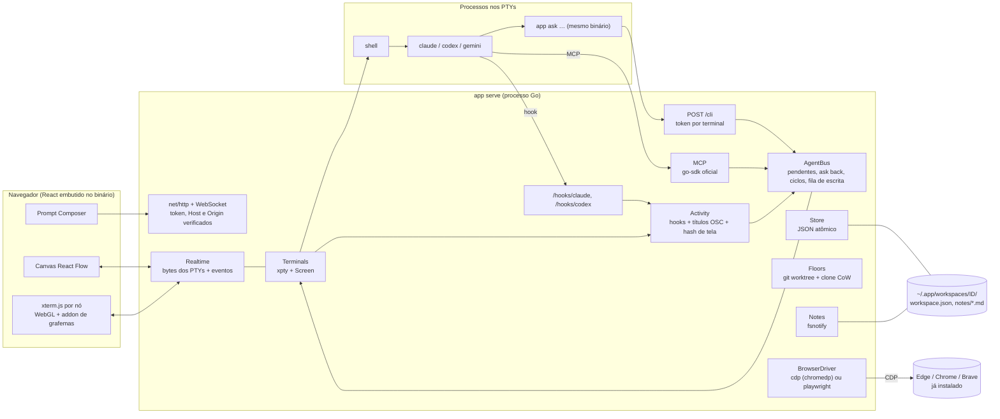

# Proposta de arquitetura em Go (backend) + React (frontend)

Esta é a alternativa ao `04-proposta-arquitetura.md` (Node). As duas implementam a mesma especificação, `03-spec-agentes-conversam.md`. Esta versão prioriza **baixo consumo de memória, estabilidade, um único binário e suporte a Windows**, e tem **duas formas de automatizar navegador**: CDP direto, sem instalar nada, ou Playwright quando estiver disponível.

As decisões abaixo foram testadas em protótipos (seção 2). Onde não houve teste, isso está dito.

## 1. Resumo da decisão

- **Backend:** Go 1.26, **um único binário** com vários papéis:
  - `app serve`: servidor HTTP/WebSocket em `127.0.0.1`, que serve também a interface;
  - `app ask|list|check|note …`: a CLI que os agentes usam (o mesmo executável, que inicia rápido e não exige Node no ambiente do terminal);
  - `app hook claude-stop` / `app hook codex-notify`: os receptores dos hooks dos agentes;
  - `app mcp`: servidor MCP por stdio.
- **Frontend:** React + Vite + React Flow + xterm.js, com o build **embutido no binário** (`embed`).
- **Terminais:** `charmbracelet/x/xpty` (PTY Unix ou ConPTY no Windows) + `charmbracelet/x/vt` (emulador no servidor), atrás de uma interface própria.
- **Navegador:** a interface `BrowserDriver` tem dois drivers. **CDP via `chromedp`** é o padrão e usa Edge, Chrome ou Brave já instalados. **Playwright** é opcional.

## 2. Evidências dos protótipos (macOS, 15/10/2026)

| Teste | Resultado |
|---|---|
| `vt` contra o xterm.js (`@xterm/headless`, a referência), com a mesma saída real gravada de `vim`, `htop`, Codex e Claude Code | `vim`, `htop` e Codex: **telas idênticas**. Claude Code: idêntica depois dos ajustes 4.2 e 4.4. |
| Modos rastreados pelo `vt` (callbacks `EnableMode`/`DisableMode`) | Rastreou tela alternativa (1049), colagem delimitada (2004), foco (1004), mouse (1000–1006) e saída sincronizada (2026), que Claude Code e Codex usam intensamente. |
| Respostas do terminal (posição do cursor, atributos do dispositivo) | O `vt` as gera em `Read()`; devolvidas ao PTY, as TUIs funcionaram normalmente. |
| Memória com 50 terminais 120×36 recebendo saída real do Codex | `vt` original: 5,25 MB por terminal (4 MB são um buffer fixo). **Com o ajuste 4.3: 1,12 MB por terminal, 82 MB no processo.** Node + xterm headless: 105 a 120 MB no processo. |
| Vazão de parsing | `vt`: ~50 MB/s. xterm headless: ~31 MB/s. |
| Portal via `chromedp` + Chrome, sem Playwright | Snapshot de acessibilidade com refs `@eN` e caixas; preencher (`Input.insertText`) e clicar por ref com eventos `isTrusted: true`; quadro de screencast em JPEG. Abrir a frio leva ~4 s; o resto, ~0,3 s. |
| Compilação para Windows (`GOOS=windows`, `CGO_ENABLED=0`) | Gravador (xpty + vt) e portal (chromedp) compilaram, cerca de 4 MB cada. **Não foram executados no Windows.** |

## 3. Arquitetura



**Concorrência por terminal:** uma goroutine lê o PTY e alimenta o filtro OSC, a `Screen` e o broadcast para o navegador. Uma segunda goroutine drena as respostas do emulador de volta ao PTY. A fila de escrita é um canal por terminal. O `AgentBus` mantém os pendentes num mapa protegido por mutex, e os temporizadores usam `time.AfterFunc`.

## 4. Camada de terminal (o ponto mais sensível)

### 4.1 Interface própria

O resto do sistema não importa o `vt` diretamente; ele conversa com esta interface:

```go
type Screen interface {
    Write(p []byte)                 // saída do PTY, já sem OSC (ver 4.2)
    Snapshot() string               // texto da tela visível (para check/ask)
    Hash() uint64                   // hash normalizado (para detecção de atividade)
    BracketedPaste() bool           // modo 2004 ativo?
    AltScreen() bool
    Resize(cols, rows int)
    Replies() io.Reader             // respostas do terminal (DA, CPR) para devolver ao PTY
}
```

- **Implementação padrão:** `charmbracelet/x/vt` (`NewSafeEmulator`, `Callbacks{EnableMode, DisableMode, AltScreen}`, `String()`, `Read()`).
- **Testes de regressão:** as gravações reais (bytes crus + tela esperada) viram golden files. Cada atualização do `vt` roda esses testes contra o xterm.js de referência.
- **Plano B:** se o `vt` regredir ou for abandonado, outra implementação da mesma interface substitui sem tocar no resto. A candidata é `libghostty-vt` via cgo, que é mais madura, mas complica a compilação cruzada.

### 4.2 Filtro de OSC na entrada (correção de bug, e também uma funcionalidade)

- **Problema medido:** o `vt` (v0.1.0) trata bytes 0x80–0x9F dentro de um OSC como controles C1. O título "✳ Tarefa" contém o byte `0x9C`, que é ST em 8 bits; a sequência terminava no meio e o resto do título aparecia na tela. O Claude Code atualiza o título com spinners o tempo todo.
- **Solução:** uma etapa de entrada (cerca de 80 linhas, com estado entre leituras) separa `ESC ] … (BEL | ESC \)` tratando o conteúdo como bytes opacos. O resto da saída segue para a `Screen`.
- **Funcionalidade que sai disso:** a etapa entrega eventos.
  - **Título (OSC 0/2):** traz o spinner do agente, um sinal de "trabalhando". O Codex mandou 48 títulos numa sessão curta.
  - **Diretório atual (OSC 7).**
  - **Progresso (OSC 9;4).**
  - **Marcas de prompt (OSC 133)**, quando o shell as emite.
- **Upstream:** reportar à Charm. Se for corrigido lá, o filtro continua útil pelos eventos.

### 4.3 Memória do emulador

- **Medido:** o `vt` pré-aloca um buffer de 4 MB por emulador para conteúdo de sequências (`emulator.go`, `SetDataSize(4 MiB)`).
- **Solução:** fork com uma linha trocada (64 KB), via `replace github.com/charmbracelet/x/vt => …` no `go.mod`, até um PR tornar esse valor configurável. Medido: **1,12 MB por terminal**, com saída idêntica.
- **Limites:** configure o scrollback por terminal (por exemplo, 5 mil linhas) e um teto global de memória.

### 4.4 Largura de caracteres

- Emojis com seletor de variação (por exemplo, "⏱️") ainda diferem em uma coluna entre o `vt` e o xterm.js no modo Unicode 11.
- **Solução:** usar o mesmo método de largura no servidor e no navegador. No frontend, carregar o addon de grafemas (ou o Unicode 11) do xterm.js; no servidor, manter o método por grafema do `vt`.
- Isso afeta só a aparência de algumas linhas com emoji; não afeta a detecção de atividade.

### 4.5 PTY e processos

- **Criação:** `xpty.NewPty(cols, rows)` devolve um PTY Unix ou um ConPTY no Windows. O processo é iniciado com `pty.Start(cmd)`.
- **Espera:** use **`xpty.WaitProcess(ctx, cmd)`**, nunca `cmd.Wait()`, que não funciona com ConPTY. O `WaitProcess` também mata o processo quando o contexto é cancelado.
- **Shell por plataforma:**
  - macOS/Linux: `$SHELL -l`;
  - Windows: `pwsh -NoLogo` (ou `powershell.exe`), `cmd.exe` ou o `bash.exe` do Git, configurável por terminal.
- **Ambiente:** `APP_TERMINAL_ID`, `APP_ENDPOINT`, `APP_TOKEN` e `APP_CLI`, com o caminho absoluto do próprio binário.
- **Parar com a árvore inteira:**
  - Unix: SIGTERM ao grupo de processos e aos descendentes, e SIGKILL depois de 2 s, como o Maestri faz;
  - Windows: **Job Object** com `KILL_ON_JOB_CLOSE` (`golang.org/x/sys/windows`), para que o agente e os filhos dele morram junto.
- **Sobreviver a reinícios:** o servidor Go costuma ser estável, então o pty-host separado da proposta Node vira opcional. Se for preciso (por exemplo, durante o desenvolvimento), rode `app ptyd` como processo próprio e fale com ele por socket local, ou use tmux no Unix.

## 5. Navegador: `BrowserDriver` com duas saídas

```go
type BrowserDriver interface {
    Open(ctx context.Context, url string, viewport Size) (PageID, error)
    Snapshot(ctx context.Context, p PageID) (Snapshot, error) // refs @eN, papel, nome, caixa
    Click(ctx context.Context, p PageID, target Target) error  // ref, seletor ou x,y
    Fill(ctx context.Context, p PageID, target Target, text string) error
    Key(ctx context.Context, p PageID, key string) error
    Scroll(ctx context.Context, p PageID, dx, dy float64) error
    Evaluate(ctx context.Context, p PageID, js string) (string, error)
    Screenshot(ctx context.Context, p PageID) ([]byte, error)
    Screencast(ctx context.Context, p PageID) (<-chan Frame, error) // para mostrar no canvas
    Close(ctx context.Context, p PageID) error
}
```

- **Driver `cdp` (padrão, nada para instalar),** feito com `chromedp`:
  - **Navegador:** o `chromedp` procura o Chrome e, no Windows, **usa o Edge** quando não o encontra; o Edge vem em todo Windows 10/11. Também dá para se conectar a um navegador já aberto com `--remote-debugging-port`.
  - **Snapshot:** `Accessibility.getFullAXTree`; para cada nó relevante, `DOM.getBoxModel` dá a caixa, e o `backendDOMNodeId` vira a ref `@eN`. Quando o nome acessível vem vazio, usa-se o texto do elemento (o protótipo mostrou esse caso em `status` e `label`).
  - **Ações:** `DOM.scrollIntoViewIfNeeded` seguido de `Input.dispatchMouseEvent` (eventos confiáveis); `DOM.focus` + `Input.insertText` para texto; `Input.dispatchKeyEvent` para teclas.
  - **Imagem:** `Page.startScreencast` envia os quadros por WebSocket ao canvas. Peça um quadro novo depois de cada ação, porque o primeiro pode vir de uma pintura anterior.
  - **Desempenho:** mantenha o navegador aberto, porque abrir a frio leva cerca de 4 s.
- **Driver `playwright` (opcional),** para quando o Playwright estiver instalado: Firefox e WebKit e o `ariaSnapshot` pronto. Pode ser via `playwright-go` (comunitário, baixa o driver do Playwright) ou chamando o Playwright MCP como processo auxiliar.
- **Formato comum:** os dois drivers devolvem o **mesmo formato de snapshot**, `@eN papel "nome" [x,y largura×altura]`, então agentes e CLI não percebem qual está em uso. A escolha é por configuração, com detecção automática: Playwright se existir, senão CDP.
- **Sem navegador nenhum** (raro): baixar sob demanda um Chromium headless (Chrome for Testing). Sem nenhum dos dois, o portal fica desabilitado.

## 6. Pacotes

```text
cmd/app/                 main: serve | ask | list | check | note | hook | mcp | ptyd
internal/server/         HTTP, WebSocket, autenticação (token, Host, Origin), embed do frontend
internal/terminal/       xpty, ambiente, linha de lançamento, Job Objects / grupos de processo
internal/screen/         interface Screen, impl vt, filtro OSC, hash normalizado, golden tests
internal/activity/       hooks + títulos OSC + heurística de tela (1 s, 500 B, 3 s; fallback 5 s)
internal/bus/            list/ask/raw/batch/check, pendentes, ask back, ciclos, fila de escrita
internal/agents/         adaptadores por agente: lançamento, papel, fim de turno, resposta, retomada
internal/mcp/            ferramentas MCP (modelcontextprotocol/go-sdk)
internal/notes/          .md + fsnotify, leitura numerada, edit/write, bloqueio
internal/roles/          biblioteca de papéis e materialização
internal/floors/         git worktree, clone CoW por plataforma, land/merge
internal/browser/        BrowserDriver: cdp (chromedp), playwright (opcional)
internal/store/          workspace.json com escrita atômica, envelope {type, schemaVersion, payload}
web/                     React + Vite (build embutido via embed)
```

## 7. Bibliotecas

| Função | Biblioteca | Observação |
|---|---|---|
| HTTP | `net/http` | O roteador da biblioteca padrão basta |
| WebSocket | `github.com/coder/websocket` | |
| PTY | `github.com/charmbracelet/x/xpty` | Unix + ConPTY, com `WaitProcess` |
| Emulador | `github.com/charmbracelet/x/vt` | Fork de 1 linha via `replace` (4.3), atrás de `Screen` |
| Navegador | `github.com/chromedp/chromedp` + `cdproto` | API genérica nova: `chromedp.Do`, `chromedp.Run[T]`, `cdp.Call`, `chromedp.Events` |
| MCP | `github.com/modelcontextprotocol/go-sdk` | SDK oficial |
| Arquivos | `github.com/fsnotify/fsnotify` | |
| Windows | `golang.org/x/sys/windows` | Job Objects |
| Banco (opcional) | `modernc.org/sqlite` | Go puro, sem cgo |
| Tipos para o React | `tygo` (ou OpenAPI) | Gera TypeScript a partir das structs Go |
| Release | GoReleaser | Binários para macOS, Linux e Windows, com assinatura |

## 8. O que muda em relação ao Maestri

As decisões de produto são as mesmas da proposta Node (`04`), seção "Onde fazer diferente do Maestri":

- hooks dos agentes como sinal principal de fim de turno;
- a última mensagem do assistente como resposta;
- envelope com o remetente;
- modo assíncrono;
- MCP além da CLI;
- papéis por mecanismo nativo, com o truque do cwd como reserva;
- HTTP local com token;
- defesa contra DNS rebinding;
- TTL contra laços.

Diferenças específicas desta versão:

| Tema | Maestri | Proposta Go |
|---|---|---|
| CLI | binário Swift separado, copiado para `$TMPDIR` | o **mesmo binário** do servidor; PATH e `APP_CLI` apontam para ele |
| Hooks | não usa | `app hook …` recebe o payload pelo stdin ou argv e repassa ao servidor |
| Sinais de atividade | hash da tela | hooks → título OSC com spinner → hash de tela, nessa ordem |
| Portal web | WKWebView com JS injetado | CDP (Edge/Chrome existentes), com Playwright opcional |
| Simulador iOS | dylib injetada + HID privado | fora do escopo inicial |

## 9. Windows: o que já está resolvido e o que validar

**Resolvido no desenho:**
- PTY por ConPTY (`xpty`) e espera por `WaitProcess`;
- árvore de processos por Job Object;
- navegador pelo Edge, que já vem instalado;
- transporte por HTTP local (sem socket Unix);
- binário sem cgo.

**Validar numa máquina ou VM Windows.** Estes riscos também valeriam para Node, que usa o mesmo ConPTY:

1. **Colagem delimitada através do ConPTY.** O ConPTY traduz a entrada; confirme que um texto multilinha chega ao Claude Code e ao Codex como colagem, sem enviar a cada linha.
2. **OSC através do ConPTY.** O ConPTY re-renderiza a saída e pode engolir títulos (spinner). Mitigações:
   - o modo de passagem direta dos Windows recentes, já que o `conpty` da Charm repassa as flags ao `CreatePseudoConsole`;
   - carregar o `conpty.dll`/`OpenConsole.exe` do Windows Terminal, como o node-pty faz com `useConptyDll`;
   - os hooks continuam sendo o sinal principal.
3. **Andares sem `cp -c`:** block cloning em ReFS/Dev Drive quando houver; senão, cópia comum ou cópia sem as pastas pesadas seguida de um comando de setup.
4. **Shells:** a linha de lançamento do agente na sintaxe de PowerShell e de cmd.

Os protótipos usados aqui (`rec`: TUI em ConPTY + emulador, com gravação; `portal`: CDP com Edge) servem como roteiro para essa validação. Eles estão em `spikes/`, com instruções no `spikes/README.md`.

**Sem máquina Windows:** use CI desde o primeiro commit. Os runners `windows-latest` do GitHub Actions têm ConPTY e Edge. Três testes automáticos cobrem os itens 1 e 2 sem depender de Claude Code ou Codex:
- um programa de teste em Go (no estilo do `research/tools/ptylog.py`) liga o modo 2004 e grava a entrada; o teste confere se uma colagem multilinha chega delimitada, e se os Enters chegam;
- o mesmo programa emite títulos OSC com UTF-8; o teste confere se eles atravessam o ConPTY;
- o driver `cdp` roda contra o Edge do runner, abre uma página local e confere snapshot, clique confiável e screencast.

Assim o risco do Windows vira teste automático e é acompanhado desde o início, em vez de ficar para o fim.

## 10. Comparação com a proposta Node (`04`)

| Critério | Node (`04`) | Go (`05`) |
|---|---|---|
| Memória (servidor + 50 terminais) | 105–120 MB | **~82 MB** (com o ajuste 4.3) |
| Distribuição | Node + `node_modules` + pty-host | **um binário** por plataforma, com o frontend embutido |
| CLI no terminal | script Node (ou empacotado) | o mesmo binário, que inicia rápido |
| Emulador no servidor | `@xterm/headless`, **o mesmo motor do frontend** (paridade natural) | `vt` + filtro OSC + golden tests (paridade medida, exige manutenção) |
| Maturidade do emulador | alta (VS Code) | média (`vt` é "experimental", v0.1.0) |
| Navegador | Playwright oficial | CDP sem instalar nada + Playwright opcional |
| Windows | node-pty/ConPTY (maduro, com `useConptyDll`) | xpty/ConPTY (`WaitProcess`; o `conpty.dll` próprio exige trabalho extra) |
| Tipos com o React | TypeScript nos dois lados | geração de tipos (`tygo`) |
| Velocidade para o primeiro protótipo | maior | um pouco menor |
| Estabilidade em execução longa | boa | **muito boa** |

## 11. Roteiro

1. **F0, esqueleto e CI:** montar o esqueleto `cmd/app` com `serve` e a CLI e o build do React embutido. Montar o CI em macOS, Linux e Windows com os testes de ConPTY e do driver `cdp` (seção 9). A validação manual numa máquina Windows, com Claude Code e Codex reais, fica para quando houver uma.
2. **F1, terminais:** `internal/terminal` + `internal/screen` (vt + filtro OSC + golden tests) + streaming para o xterm.js; canvas com dois terminais.
3. **F2, conversa:** `internal/bus` + `POST /cli` + hooks do Claude e do Codex + heurística; ask back e ciclos. Use os critérios de aceitação da spec como testes.
4. **F3, notas, Composer e MCP.**
5. **F4, papéis e andares** (CoW por plataforma).
6. **F5, portais:** driver CDP primeiro, Playwright depois.
7. **F6, extras:** resumos com LLM, Android, uso remoto.

## 12. Riscos e mitigação

| Risco | Mitigação |
|---|---|
| O `vt` muda de API ou regride | Interface `Screen`, golden tests, versão fixada, plano B (`libghostty-vt`) |
| Bug ou ajuste não aceito upstream | Fork via `replace`, com patches pequenos e documentados |
| ConPTY se comporta diferente no Windows | Validação F0, passthrough ou `conpty.dll`, hooks como sinal principal |
| TUIs dos agentes mudam a cada versão | Hooks e MCP reduzem a dependência da tela; gravações novas viram golden tests |
| Navegador ausente | Detecção (Edge, Chrome, Brave), Playwright opcional, download sob demanda |
